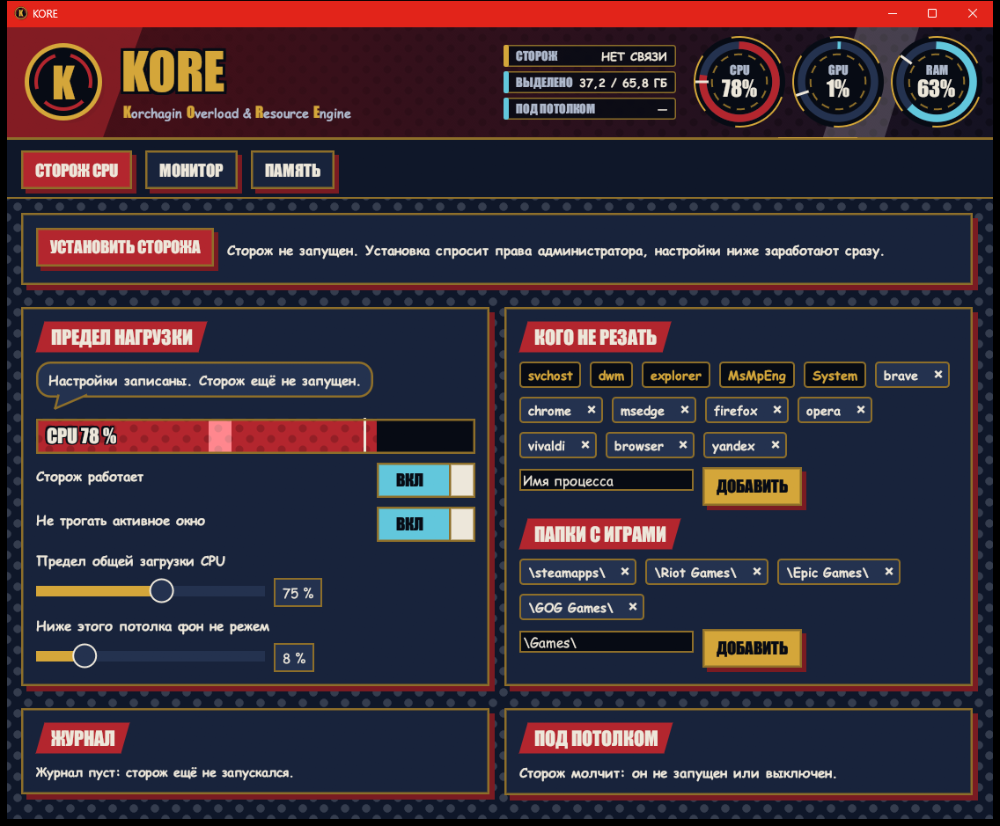
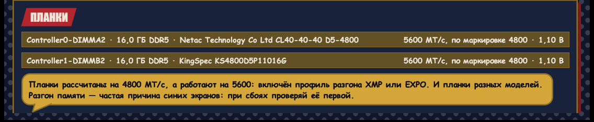

# KORE — Korchagin Overload & Resource Engine

Пульт загрузки ПК для Windows: сторож CPU, графики процессора, видеокарты и памяти, разбор оперативной памяти по процессам и планкам.



## Что умеет

- **Сторож CPU.** Держит общую загрузку процессора ниже предела. Когда ПК перегружен, самым прожорливым фоновым процессам ставится жёсткий потолок CPU через Job Object Windows. Процессы не закрываются и не замораживаются, только замедляются. Когда появляется запас, потолок поднимается. Активное окно, браузеры и игры из списков сторож не трогает.
- **Монитор.** Живые графики загрузки CPU, GPU и памяти за последние 4 минуты.
- **Память.** Сколько занято и сколько «выделено с подкачкой», как в диспетчере задач. Кто держит память: выделенная память и рабочий набор по процессам. Планки: слот, объём, модель, частота и напряжение. Если планки работают быстрее своей маркировки, пульт предупреждает о разгоне.



Всё, что меняется в окне, сразу пишется в `guard\guard.conf`, а сторож перечитывает файл на ходу.

## Требования

- Windows 10 или 11, 64 бита.
- Видеокарта с Direct3D 12.
- Загрузку GPU пульт берёт у `nvidia-smi`, поэтому она видна только с видеокартой NVIDIA. Всё остальное работает с любой.
- Чтобы поставить сторожа, нужны права администратора: Windows спросит их сама.

## Как пользоваться

1. Положите `KORE.exe` и папку `guard` рядом.
2. Запустите `KORE.exe`.
3. На вкладке «Сторож CPU» нажмите «Установить сторожа» и подтвердите запрос Windows. Сторож встанет задачей «KORE guard» и будет запускаться при входе в Windows.
4. Предел, списки «Кого не резать» и «Папки с играми» настраиваются прямо в окне.

Снять сторожа: `powershell -ExecutionPolicy Bypass -File guard\install-guard.ps1 -Remove` от имени администратора. Скрипт сначала снимет все потолки, потом удалит задачу.

## Приватность

Пульт ничего не отправляет в интернет и не собирает данные. Он только читает счётчики Windows, а сторож меняет потолки CPU у процессов на этом ПК.

## Сборка из исходников

Нужен Rust stable с тулчейном MSVC (`rust-toolchain.toml` выберет его сам) и Windows SDK для иконки.

```powershell
cargo build --release
```

Готовый портативный архив с exe, папкой `guard` и лицензиями собирает `build-release.ps1`:

```powershell
powershell -ExecutionPolicy Bypass -File build-release.ps1
```

Своё приложение может подключить KORE как библиотеку, добавить вкладки и плашки шапки через `kore::Extra` и открыть окно через `kore::run`.

## Лицензия

[PolyForm Noncommercial 1.0.0](LICENSE): смотреть, собирать, менять и использовать для себя можно, использовать в коммерческих целях и продавать нельзя. За коммерческой лицензией пишите в Issues.

Лицензии сторонних библиотек — в [THIRD-PARTY-NOTICES.txt](THIRD-PARTY-NOTICES.txt). Шрифты Impact и Comic Sans MS пульт берёт из Windows, если они установлены, и сам их не распространяет.

---

**English.** KORE is a Windows PC load panel: a CPU guard that hard-caps background processes through Job Objects while leaving the active window, browsers and games alone, live CPU/GPU/RAM charts, per-process committed memory and RAM stick details with an overclock warning. No network access, no telemetry. Rust + egui on wgpu/Direct3D 12. Licensed under PolyForm Noncommercial 1.0.0.
